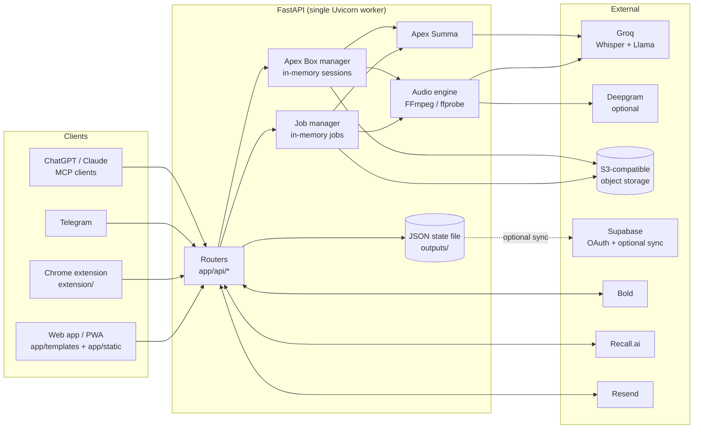

# Apex Vox

[](https://github.com/mateopiza/apex-vox/actions/workflows/ci.yml)
[](LICENSE)

Apex Vox transcribes meetings. You upload one or more audio files, or record a meeting, and get back a transcript split by speaker with timestamps, plus an AI report (who spoke most, topics, goals, alerts, tasks) and formal meeting minutes. It is a FastAPI app with a plain-JavaScript web UI (Spanish and English), a Chrome extension, a meeting bot, and an MCP connector so ChatGPT and Claude can read your meetings.

Live instance: <https://apex-vox.ialabs.app>

## Features

**Transcription (Apex Vox)**
- Upload several audio files (MP3, OGG, WAV, M4A, FLAC, WEBM, MP4), put them in order, and transcribe them as one timeline.
- Speech-to-text with Groq Whisper. Long files are cut at silences into chunks under 25 MB, and timestamps are shifted back onto one global timeline.
- Speaker diarization through four engine presets. Deepgram is optional: without a Deepgram key the presets that use it fall back to Groq-only or local processing.

  | Preset | Internal engine | What it does |
  | --- | --- | --- |
  | Mc-Ayrton | `deepgram` | Deepgram transcription and diarization (falls back to Groq Whisper plus local voiceprints without a key) |
  | Mc-Lewis (default) | `hybrid_deepgram_groq` | Groq Whisper text with speaker turns from Deepgram (local voiceprints without a key) |
  | Mc-Norris | `acoustic_local` | Groq Whisper plus local voiceprint clustering (NumPy) |
  | Mc-Piastri | `groq_llm` | Groq Whisper plus LLM-based (Llama on Groq) speaker attribution |
- Removal of hallucinated text in silent stretches, speaker renaming, and enrolled voice profiles (each one private to its account).
- Export to TXT, SRT, VTT, JSON, CSV and Markdown, plus playback of the merged audio.

**AI report (Apex Summa)**
- Talk time per speaker, topics, objectives, alerts with timestamps, a calendar of upcoming tasks (`.ics` export), and charts.
- Minutes generator with five templates (board, committee, general assembly, follow-up, executive), in Spanish or English.
- Free accounts get a preview. The full report, minutes and calendar require Apex Pro.

**Recording (Apex Box)**
- Recording in 3-minute blocks. Each block is uploaded and transcribed as soon as it ends, so the browser keeps only one block in memory and sessions can run for hours.
- In-person mode (microphone) and virtual mode (meeting tab or screen audio mixed with the microphone), with timestamped live notes (note, agreement, task, alert, idea, question).
- Works in the web app (`/?view=box`, keeps the screen awake with the Wake Lock API) and in a Chrome MV3 extension ([`extension/`](extension/)) that records from a pinned tab, signs in through the web session, and shows a sound meter that warns when no sound is coming in.

**Meetings and integrations**
- Meeting bot (Recall.ai, Apex Pro): sends a bot into a Zoom, Google Meet, Microsoft Teams or Webex call, then transcribes the recording and emails a link to the result.
- Calendar invitations by email (Resend Inbound): invite the configured address to a meeting and the bot is scheduled to join it automatically.
- MCP server for ChatGPT and Claude: OAuth 2.1 with PKCE and dynamic client registration, and five read-only tools ([docs/mcp.md](docs/mcp.md)).
- Telegram bot (Apex Pro): send a voice note to a linked chat and get its transcript back.

**Accounts and plans**
- Email and password accounts (PBKDF2-SHA256), Google or GitHub sign-in through Supabase OAuth, and a guest mode with no account.
- Plans:

  | | Guest | Free | Apex Pro |
  | --- | --- | --- | --- |
  | Audio | 3 audios/day, 30 min each | 2 h/day | Unlimited |
  | Results stored | 60 min, in memory | 24 h | While the account exists |
  | Apex Summa / minutes | No | Preview | Full |
  | Meeting bot, Telegram, MCP summaries | No | No | Yes |

- Apex Pro costs USD 10 for 30 days, paid through Bold payment links and renewed by hand (there is no automatic charge). Paying within 24 hours of signing up gives a 20% welcome discount, limited to one discount per network every 90 days.
- Transactional emails and a double opt-in newsletter (Resend), installable PWA, and legal pages (terms, Habeas Data, privacy, security) plus `/.well-known/security.txt`.

## Screenshots

> Screenshots are not committed yet. Contributions are welcome: add PNG files under `docs/screenshots/` and link them here.

| View | File |
| --- | --- |
| Studio (upload, order, transcribe) | `docs/screenshots/studio.png` (planned) |
| Transcript and Apex Summa report | `docs/screenshots/summa.png` (planned) |
| Apex Box recorder (extension) | `docs/screenshots/recorder-tab.png` (planned) |

## Architecture



There is a single Uvicorn worker on purpose: jobs, Apex Box sessions and rate-limit counters live in process memory. Accounts, tokens, payments and other state are kept in one JSON file on the data volume. Details: [docs/architecture.md](docs/architecture.md).

## Quick start

You need either Docker, or Python 3.11 with `ffmpeg` and `ffprobe` on your `PATH`, plus a [Groq API key](https://console.groq.com/keys). Every other integration is optional.

### Docker Compose

```bash
cp .env.example .env
# Edit .env and set at least:
#   GROQ_API_KEY=gsk_...
#   APP_SECRET_KEY=$(python -c "import secrets; print(secrets.token_hex(32))")
docker compose up -d --build
```

Open <http://localhost:8000>. Check health with `curl http://localhost:8000/api/health`. With `ENVIRONMENT=development` (the value in `.env.example`), interactive API docs are at <http://localhost:8000/docs>.

### Local (uv or pip)

```bash
# with uv
uv venv --python 3.11
source .venv/bin/activate
uv pip install -r requirements-dev.txt

# or with pip
python3.11 -m venv .venv
source .venv/bin/activate
pip install -r requirements-dev.txt

cp .env.example .env            # set GROQ_API_KEY
uvicorn app.main:app --reload --port 8000
```

Runtime data goes to `uploads/`, `outputs/` and `temp/` in the project root.

## Configuration

All settings come from environment variables, and `.env` is loaded automatically. [`.env.example`](.env.example) lists every supported variable with placeholder values. Each variable, its default and whether it is required is described in [docs/configuration.md](docs/configuration.md).

The minimum for a working instance is `GROQ_API_KEY`. In production also set `ENVIRONMENT=production`, `PUBLIC_BASE_URL`, `ALLOWED_HOSTS`, `CORS_ORIGINS`, `APP_SECRET_KEY`, `ADMIN_API_KEY` and `ENABLE_HSTS=true`.

## Running tests

The test suite generates real audio and runs it through FFmpeg, so **`ffmpeg` and `ffprobe` must be installed**. External APIs (Groq, Deepgram, Bold, Recall.ai, Resend) are mocked, so you need no real keys.

```bash
pip install -r requirements-dev.txt
python -m pytest -q
```

Or run the tests inside the Docker image:

```bash
docker build -t apex-vox-test --build-arg INSTALL_DEV_DEPS=true .
docker run --rm apex-vox-test python -m pytest -q -p no:cacheprovider
```

CI ([`.github/workflows/ci.yml`](.github/workflows/ci.yml)) runs the tests, a `ruff` syntax check, `node --check` on the JavaScript, and a Docker build.

## Project structure

```text
.
├── app/
│   ├── main.py              # FastAPI app, middleware, security headers, UI, legal pages, PWA, health, background loops
│   ├── config.py            # Settings from environment variables, engine/model aliases (Mc-*)
│   ├── api/                 # Routers: auth, billing, box, mcp, meetings, upload, transcribe, export, telegram
│   │   └── deps.py          # Session resolution, client IP (Cloudflare-aware), throttle, admin key
│   ├── models/schemas.py    # Pydantic request/response models
│   ├── services/            # Audio engine, Groq/Deepgram, diarization, Apex Summa, Apex Box, storage,
│   │                        # accounts/state, Bold, Recall.ai, calendar invites, MCP OAuth/server,
│   │                        # email, Telegram, legal texts, usage reports
│   ├── templates/index.html # Single-page web UI shell
│   └── static/              # CSS (design tokens), JS (app.js, oauth-consent.js), icons, OG images
├── extension/               # Apex Box Chrome extension (Manifest V3)
├── supabase/                # SQL schema, migration (RLS hardening), Auth email templates
├── tests/                   # pytest suite (audio fixtures generated with FFmpeg)
├── brand/                   # Marketing image sources and render script
├── docs/                    # Project documentation
├── Dockerfile
├── docker-compose.yml
├── requirements.txt
└── requirements-dev.txt
```

## Documentation

| Document | Contents |
| --- | --- |
| [docs/architecture.md](docs/architecture.md) | Components, request flows, data storage, background loops |
| [docs/configuration.md](docs/configuration.md) | Every environment variable |
| [docs/api.md](docs/api.md) | HTTP API reference by router, MCP tools, OAuth endpoints |
| [docs/deployment.md](docs/deployment.md) | Docker, reverse proxy, Cloudflare, backups, webhooks |
| [docs/mcp.md](docs/mcp.md) | Connecting ChatGPT and Claude |
| [docs/extension.md](docs/extension.md) | Chrome extension: install, internals, permissions, publishing |
| [docs/security.md](docs/security.md) | Threat model, controls in the code, rotating credentials |
| [CHROMEWEBSTORE.md](CHROMEWEBSTORE.md) | Chrome Web Store listing draft |
| [CHANGELOG.md](CHANGELOG.md) | Release history |

## Contributing, security and support

- Contributions: read [CONTRIBUTING.md](CONTRIBUTING.md) and the [Code of Conduct](CODE_OF_CONDUCT.md).
- Vulnerabilities: report them privately as described in [SECURITY.md](SECURITY.md), never in public issues.
- Questions: see [SUPPORT.md](SUPPORT.md).

Powered by [Groq](https://groq.com). "Groq", "Deepgram", "Recall.ai", "Resend", "Supabase", "Bold", "Zoom", "Google Meet", "Microsoft Teams", "Webex", "ChatGPT" and "Claude" are trademarks of their respective owners. This project is not affiliated with them.

## License

[MIT](LICENSE). Copyright (c) 2026 Mateo Piza and IA Labs.
