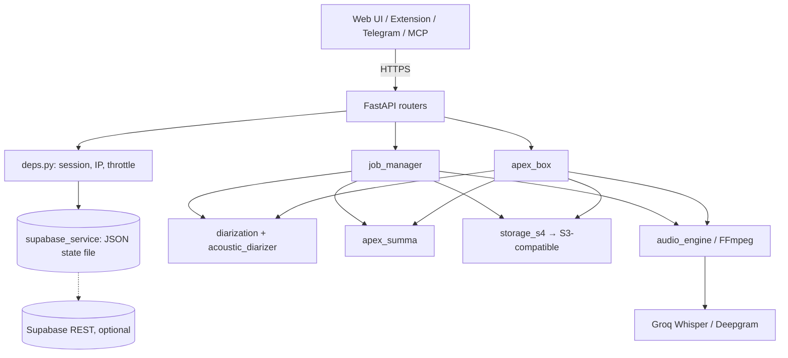
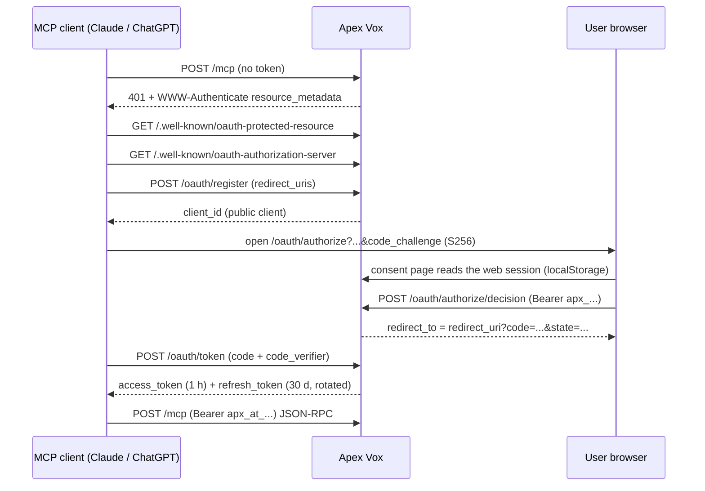

# Architecture

Apex Vox is a single FastAPI process. The web UI is static HTML and JavaScript served by the same app. Audio is processed with FFmpeg. Speech-to-text and the LLM run on Groq, and every other integration is reached over HTTPS.

## Components

| Component | Location | Responsibility |
| --- | --- | --- |
| App entrypoint | `app/main.py` | Middleware (CORS, GZip, TrustedHost, security headers), UI shell with SEO and language detection, legal pages, PWA manifest and service worker, `robots.txt`, `sitemap.xml`, `security.txt`, `/api/health`, background loops |
| Settings | `app/config.py` | Typed settings from environment variables. Maps the `Mc-*` presets to internal engines and models |
| Request helpers | `app/api/deps.py` | Session resolution (`Authorization: Bearer apx_...`), monthly network limit, client IP, in-process throttle, admin key check |
| Routers | `app/api/routes_*.py` | HTTP API (see [api.md](api.md)) |
| Job manager | `app/services/job_manager.py` | Upload sessions, transcription jobs, the end-to-end pipeline, result persistence |
| Audio engine | `app/services/audio_engine.py` | `ffprobe` probing, silence detection, chunking under 25 MB, timeline offsets, MP3 extraction |
| Groq / Deepgram | `groq_service.py`, `deepgram_service.py` | Whisper transcription, Deepgram transcription and diarization |
| Diarization | `diarization.py`, `acoustic_diarizer.py`, `transcript_cleaner.py` | LLM and heuristic speaker labelling, NumPy voiceprints and clustering, enrolled voice profiles, removal of hallucinated text |
| Apex Summa | `apex_summa.py` | Speaker analytics, topics, objectives, callouts, tasks, charts (heuristics plus an optional Groq LLM pass), `.ics` calendar, minutes templates |
| Apex Box | `apex_box.py` | Block-recording sessions, incremental transcription per block, live notes, finalization, extension ZIP packaging |
| Accounts and state | `supabase_service.py` | Users, sessions, quotas, payments, promo, IP limits, one-time tokens, transcription index. Persisted in a JSON file, with optional push to Supabase |
| Object storage | `storage_s4.py` | SigV4 client for any S3-compatible provider, plus a local mirror and retention index |
| Payments | `bold_service.py` | Bold payment links, webhook signature check, period activation |
| Meeting bot | `recall_service.py` | Recall.ai bots, Svix webhook check, recording download and processing |
| Invitations | `calendar_invites.py` | Resend Inbound email fetch, `.ics` parsing, bot scheduling |
| MCP | `mcp_oauth.py`, `mcp_server.py`, `routes_mcp.py` | OAuth 2.1 authorization server and JSON-RPC MCP server |
| Email | `email_service.py` | Resend transactional templates (ES/EN), newsletter contacts |
| Telegram | `telegram_service.py` | Bot webhook, chat linking, transcription of voice notes |
| Usage report | `usage_reporter.py` | Daily usage, cost and revenue estimate sent to Telegram or a webhook |
| Legal | `legal_content.py` | Terms, Habeas Data, privacy and security policy pages (ES/EN), `security.txt` |
| Web UI | `app/templates/index.html`, `app/static/js/app.js` | Single-page app: Studio, results, Apex Summa, Apex Box, account portal, i18n |
| Extension | `extension/` | Chrome MV3 recorder (see [extension.md](extension.md)) |

## Request flows

### Transcription pipeline

1. `POST /api/upload` (multipart, one or more files) creates or extends an **upload session**, owned by the account id or, for guests, by an HMAC of the client IP. Each file is probed with `ffprobe`. Guests are capped at `GUEST_MAX_AUDIOS_PER_DAY` audios of at most `GUEST_MAX_AUDIO_MINUTES` minutes each.
2. The UI can reorder (`PUT /api/sessions/{id}/order`) or remove tracks.
3. `POST /api/transcribe` checks session ownership, resolves the engine (`Mc-*` → internal key), and starts a background thread. The plan and identity come from the session token. Any `api_key`, `deepgram_api_key` or `user_id` in the body is discarded.
4. `job_manager.execute_job`:
   1. Chunks each track at silences into pieces under 25 MB and computes the global timeline offsets.
   2. Checks and consumes the daily quota (free plan) based on the total duration.
   3. Builds one merged MP3 (`outputs/{job_id}_merged.mp3`) for playback and voiceprints.
   4. Transcribes with Groq Whisper, or with Deepgram for Mc-Ayrton when a key is configured. It adds Deepgram speaker turns (Mc-Lewis) or local voiceprint clustering (Mc-Norris, or as a fallback).
   5. Filters hallucinated segments, diarizes (LLM, heuristic or acoustic labels), matches enrolled voice profiles, and filters again.
   6. **Guests:** keeps the result in memory only, purges it after `GUEST_RESULT_TTL_MINUTES`, and deletes the session files. No Apex Summa report is generated.
   7. **Accounts:** generates the Apex Summa report (locked preview on the free plan), writes `outputs/{job_id}_result.json`, uploads the result and the merged audio to object storage under `users/{user_id}/jobs/{job_id}/`, and records the transcription in the state file (pushed to Supabase if configured).
5. The client polls `GET /api/jobs/{id}/status`, then fetches `/result`, `/summa`, `/minutes`, `/calendar.ics` and `/export/{fmt}`.

### Apex Box block recording

1. The client (web app or extension) calls `POST /api/box/sessions` with a signed-in session. Free accounts with no quota left get `402`.
2. The recorder runs a `MediaRecorder` on one continuous `MediaStream` (Opus/WebM at 48 kbps when supported). Every 180 s it starts a new recorder and stops the previous one, so each block is a self-contained file with its own header.
3. Each block goes to `POST /api/box/sessions/{id}/blocks` with `block_index` and `duration_hint_sec`. The server consumes quota, aligns the block to the session timeline, converts it to MP3, transcribes it right away, and returns the new segments. The client drops the block from memory.
4. Notes are added at any time (`/notes`), stamped with the timeline position.
5. `POST /api/box/sessions/{id}/finalize` merges the block MP3s, adds the notes to the transcript, generates Apex Summa and (optionally) minutes for the chosen template, and persists everything like a normal job. The response contains the `job_id`, and the UI links to `/?job={job_id}`.

Box sessions themselves live in memory (`apex_box_manager`). Only the finalized job is persisted.

### Meeting bot (Recall.ai)

1. An Apex Pro user calls `POST /api/meetings/bot` with a Zoom, Meet, Teams or Webex URL (throttled to 10 per hour per account).
2. `recall_service.create_bot` asks Recall.ai to join (immediately, or at `join_at` for scheduled invites) and asks for a mixed MP3 recording. The bot record is stored in the state file.
3. Recall.ai calls `POST /api/recall/webhook` (Svix-signed) with status events. On `bot.done` a background thread downloads the recording, cuts it into 180 s blocks, feeds them through an Apex Box session, finalizes with minutes, and emails the user a link.

### Calendar invitations (Resend Inbound)

1. The user invites `INVITES_ADDRESS` to a meeting, or forwards the invitation to it.
2. Resend calls `POST /api/inbound/resend` (Svix-signed) with `email.received`. The handler returns at once and processes the email in a background thread.
3. `calendar_invites.process_inbound_email` fetches the email via the Resend API (`RESEND_INBOUND_API_KEY`). It rejects messages that fail both SPF and DKIM, downloads the raw MIME, and extracts `.ics` parts.
4. Each `VEVENT` is assigned to the account whose email matches the **sender** or the **organizer**. Being listed as an attendee is not enough. The event is stored. For Apex Pro accounts with a meeting link and a future start time, a bot is scheduled one minute before the start. Updated or cancelled events reschedule or cancel the bot.

### MCP OAuth flow

Details and the list of tools are in [mcp.md](mcp.md).

### Sign-in with Google or GitHub

`GET /api/auth/oauth/{provider}` creates a PKCE pair, keeps the verifier in a short-lived HttpOnly cookie scoped to `/api/auth/oauth`, and redirects to Supabase Auth. The callback exchanges the code with Supabase, creates or updates the local account, and redirects to `/?auth_code=...`. The UI swaps that one-time code (valid 120 s) for a session through `POST /api/auth/oauth/exchange`.

### Payments (Bold)

`POST /api/billing/checkout` computes the price on the server (regular or promo), creates a Bold payment link in USD, and records a pending payment. Bold notifies `POST /api/billing/bold/webhook` (HMAC-signed). `SALE_APPROVED` grants `PRO_PERIOD_DAYS` of Apex Pro to the account embedded in the order reference. `POST /api/billing/confirm` asks Bold for the link status, which covers payers who return before the webhook arrives.

## Data storage

| Data | Where | Notes |
| --- | --- | --- |
| Accounts, session tokens, quotas, payments, promo IP hashes, password-reset and newsletter tokens, OAuth clients/codes/tokens, meeting bots, calendar events, Telegram links, transcription index | `outputs/supabase_cloud_state.json` | One JSON file, read and rewritten under a process-wide lock. **This is the source of truth.** |
| Server HMAC secret (if `APP_SECRET_KEY` is unset) | `outputs/.app_secret` (mode 600) | Generated on first use. Losing it invalidates IP hashes, OAuth tokens and one-time codes |
| Enrolled voice profiles | `outputs/voice_profiles.json` | Embeddings plus owner id |
| Job results and merged audio | `outputs/{job_id}_result.json`, `outputs/{job_id}_merged.mp3` | Loaded back into memory on demand |
| Object storage mirror and index | `outputs/mega_s4_bucket/` | Local copy of every uploaded object, plus a retention index |
| Daily reports | `outputs/reports/` | Written by the usage reporter |
| Uploaded audio | `uploads/` | Upload session tracks |
| Scratch files | `temp/` | Per-job chunk directories, removed after each job when `CLEANUP_TEMP_FILES=true` |
| Remote objects | S3-compatible bucket | `users/{user_id}/jobs/{job_id}/result.json` and `merged.mp3`, plus `public/extension/apex-box-chrome-extension-v{version}.zip` |
| Optional mirror | Supabase PostgREST | `profiles` (on sign-up) and `transcriptions` (on each job), pushed with the service-role key. Write-only: the app never reads them back. Schema: `supabase/` |

Without object-storage credentials, objects are written to the local mirror only. Without Supabase credentials, nothing is pushed and Google/GitHub sign-in is disabled.

## Background loops

All loops are daemon threads started in the FastAPI `startup` hook (`app/main.py`), or per request.

| Loop | Schedule | What it does |
| --- | --- | --- |
| Telegram webhook registration | Once at startup | Calls `setWebhook` with `PUBLIC_BASE_URL/api/telegram/webhook` and the secret token, when `TELEGRAM_BOT_TOKEN` and `PUBLIC_BASE_URL` are set |
| Daily usage report | Every day at 23:55 (UTC-5, America/Bogota) | Computes usage, cost and revenue estimates and sends them to `TELEGRAM_CHAT_ID`. Runs only if `TELEGRAM_BOT_TOKEN` and `TELEGRAM_CHAT_ID` are set |
| Billing emails | Every 15 minutes | Sends the promo-ending reminder, the renewal reminder (`RENEWAL_REMINDER_DAYS` before expiry) and the expired notice, once each per user |
| Transcription workers | Per `POST /api/transcribe` | One thread per job |
| Guest purge | `GUEST_RESULT_TTL_MINUTES` after a guest job | `threading.Timer` removes the in-memory result and the merged audio |
| Webhook processing | Per Recall `bot.done`, Resend `email.received`, Telegram update | Heavy work runs off the request thread |
| Email sending | Per email | `email_service.send_async` sends in a thread |

## Scaling notes

- **Run one worker.** Jobs, Box sessions, the throttle counters and the OAuth provider cache are in process memory, and the JSON state file is protected by an in-process lock only. Running several workers or replicas would corrupt state and split sessions. To scale out, move `job_manager`, `apex_box_manager` and `supabase_service` onto a shared store first.
- Restarting the process loses in-flight jobs and open Box sessions. Finished results survive on disk.
